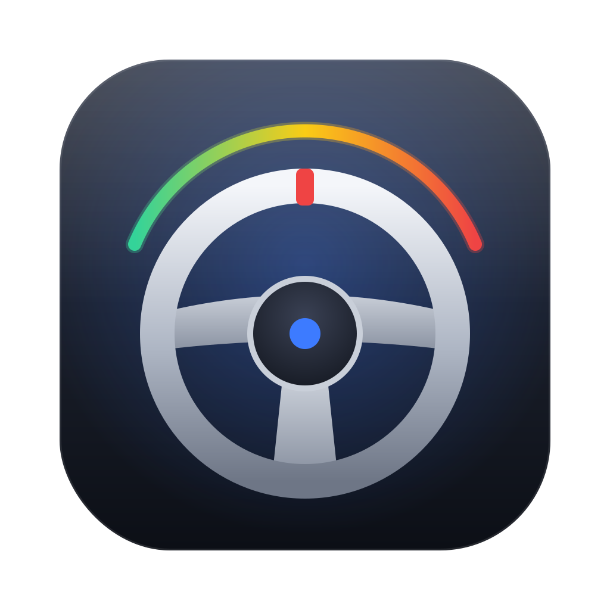

<p align="center">
  
</p>

<h1 align="center">G29 Control</h1>

<p align="center">
  <b>Set up your Logitech G29 racing wheel on macOS without G HUB.</b><br>
  Soft steering, separate pedals, full 900° rotation and a live view of every input.
</p>

<p align="center">
  
  
  
  
</p>

---

## Why

Plugged straight into a Mac, the Logitech G29 often behaves badly:

- 🛞 **The wheel is very heavy.** Its built-in centering spring is on at full strength.
- 🦶 **The car stops when you release the gas.** The wheel starts in a fallback mode where gas and brake share one axis, so lifting off the gas reads as braking.
- ↔️ **Rotation is limited** to about 200° instead of 900°.
- 🔒 **G HUB doesn't help,** and it can even lock the wheel so nothing else can configure it.

G29 Control is a small, native Mac app that fixes these problems with one click. It doesn't install drivers or kernel extensions.

## Features

| | |
|---|---|
| **Soft or firm steering** | Centering spring from 0 (free) to 100%, applied when you release the slider |
| **Rotation range** | 40–900°, with quick 180 / 270 / 540 / 900° presets |
| **Native mode switch** | Switches the wheel to native G29 mode automatically: separate gas, brake and clutch |
| **Live dashboard** | Steering angle, every pedal, buttons and D-pad, updated in real time |
| **Auto-apply** | Your settings go to the wheel every time it's plugged in, once it has finished calibrating |
| **Automatic updates** | Checks GitHub for new releases, then downloads, installs and relaunches in one click |
| **Menu bar controls** | Rotation and centering presets, even with the window closed |
| **Force feedback and rev-light tests** | Check that the motor and LEDs respond |
| **G HUB detection** | Warns when G HUB is locking the wheel and offers to quit it |
| **Clear diagnostics** | An Activity window shows the exact macOS error and what to do about it |
| **Native Mac design** | Liquid Glass on macOS 26 Tahoe, frosted panels on macOS 13–15, plus a unified toolbar, Settings (⌘,) and dark mode |

<!-- Add a screenshot here, e.g.:
<p align="center"></p>
-->

## Requirements

- macOS 13 Ventura or later, on Apple Silicon or Intel
- Logitech G29 with **its power adapter connected**
- The mode switch on the wheel set to **PS3**

A USB-A to USB-C adapter works fine.

## Installation

### Download (easiest)

1. Download **`G29Control.dmg`** from the [latest release](../../releases/latest).
2. Open it and drag **G29 Control** into **Applications**.
3. The first time, **right-click the app → Open → Open**. The app isn't notarized by Apple, so macOS asks once.

If macOS says the app "is damaged and can't be opened", run this once in Terminal:

```sh
xattr -dr com.apple.quarantine "/Applications/G29 Control.app"
```

### Build from source

You need Apple's developer tools. Xcode 26 or newer gives you the Liquid Glass look, and older versions build with the frosted look.

```sh
xcode-select --install            # once, if you don't have Xcode or its tools
git clone https://github.com/<your-username>/G29Control.git
cd G29Control
./build.sh --install              # builds and installs into /Applications
```

| Command | What it does |
|---|---|
| `./build.sh` | Builds and opens the app without installing it |
| `./build.sh --install` | Builds and installs into `/Applications` |
| `./build.sh --release` | Builds `dist/G29Control.dmg` and `dist/G29Control.zip` |

## Getting started

1. **Quit Logitech G HUB.** If it's running, the app shows a banner with a **Quit G HUB** button.
2. **Plug in the wheel** (USB and power) and wait for it to finish calibrating.
3. **Choose the feel you want:**
   - *Centering spring* **0%** gives a free, soft wheel. **10–20%** gives a light pull to center.
   - *Rotation* **900°** gives realistic steering, while **270–540°** is quicker for arcade games.
4. **Start your game.** Keep G29 Control running in the menu bar, so your settings are re-applied whenever the wheel reconnects (a few seconds after plug-in, when the wheel stops its calibration turn).

## Setting up the pedals in games

In native mode the G29 reports each pedal on its own axis:

| Pedal | Axis |
|---|---|
| Gas | **Z** |
| Brake | **Rz** |
| Clutch | **Y** |

The game may list the axes in a different order from your pedals. The easiest way is to click each control in the game's settings and press the matching pedal.

### Euro Truck Simulator 2 / American Truck Simulator

- Map **Throttle → Z**, **Brake → Rz** and **Clutch → Y** in *Options → Controls*.
- With your feet off the pedals, both the throttle and brake bars should show **0**. If one shows full, tick **Invert** for that axis.
- If the truck slows hard when you lift off the gas, turn off **Automatic engine brake** and **Automatic retarder**.
- If the brake feels on/off, raise **Non-linearity** on the brake axis.

## Troubleshooting

| Problem | Fix |
|---|---|
| *"Another app is holding the wheel"* or a write fails | Quit G HUB, then unplug and replug the wheel. If G HUB keeps restarting, turn off its *Start on login* option or uninstall it. |
| *"macOS is blocking access"* | Go to *System Settings → Privacy & Security → Input Monitoring*, enable **G29 Control**, then reopen the app. |
| Wheel shows **PS4 mode** | Move the switch on the wheel to **PS3**, then unplug and replug it. |
| Wheel not detected | Check that the power adapter is connected and that the wheel calibrated (turned left and right) at power-on. |
| Wheel still heavy *while driving* | That's the game's force feedback. Lower it in the game's settings. |
| Settings lost after unplugging | Normal: the wheel forgets them. Keep the app in the menu bar with auto-apply on. |

When reporting a bug, open **Activity → Copy Diagnostics** and paste the result into your issue.

## Updates

G29 Control checks for a new release when it starts and once a day after that. When one is available, a banner appears in the main window (and an item in the menu bar). Click **Install Update** and the app downloads the new version, replaces itself and relaunches. You can also use **G29 Control → Check for Updates…**, or turn off automatic checks in Settings (⌘,).

In-place updates need the app to be in a folder you can write to, such as **Applications**. If it's running from the disk image, the app opens the release page instead. After an update, macOS may ask you to allow Input Monitoring again.

## How it works

G29 Control talks to the wheel directly over **USB HID** through Apple's **IOKit** framework. It runs entirely in user space, with no drivers, kernel extensions or background services.

It sends the same commands Logitech's own software uses:

| Command | Purpose |
|---|---|
| `F8 0A` and `F8 09 05 01 01` | Switch from compatibility mode to native G29 mode |
| `F8 81 lo hi` | Set rotation range in degrees |
| `F5` / `FE 0D …` + `14` | Turn the centering spring off, or set its strength |
| `F8 12 mask` | Rev-light LEDs |
| `11 08 level 80` / `13 00` | Constant force (motor test) and stop |

The protocol is documented by the Linux kernel's `hid-lg4ff` driver and the [new-lg4ff](https://github.com/berarma/new-lg4ff) project, which made this app possible.

### Project layout

```
Sources/G29Control.swift     the whole app: wheel protocol, device handling and SwiftUI interface
Resources/AppIcon.*          app icon (SVG source, PNG, ICNS)
Resources/IconLayers/        icon layers for Apple's Icon Composer
build.sh                     build, install and package script (universal binary)
.github/workflows/           CI build and automatic GitHub Releases
```

## Disclaimer

This is an independent, community project. It isn't affiliated with, endorsed by or supported by Logitech. *Logitech*, *G29* and *G HUB* are trademarks of Logitech. Use at your own risk.

## License

Released under the [MIT License](LICENSE).
